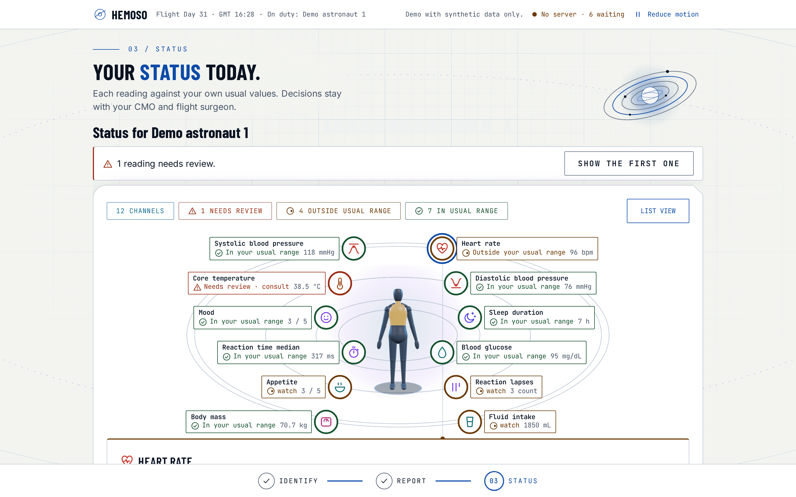
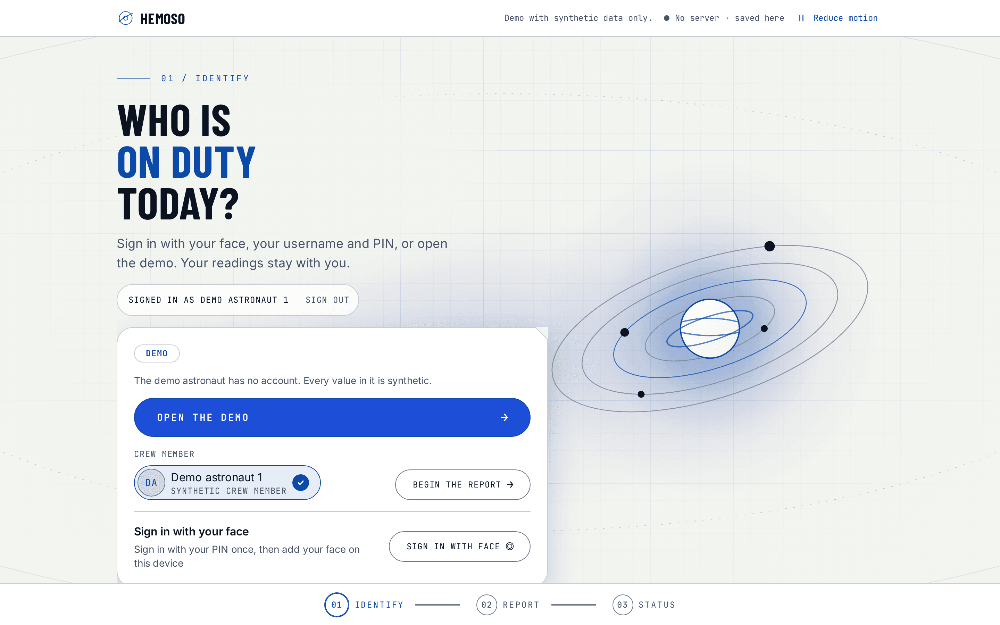
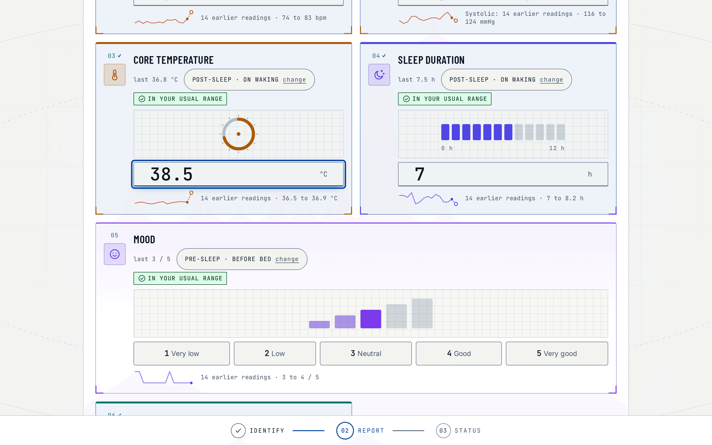
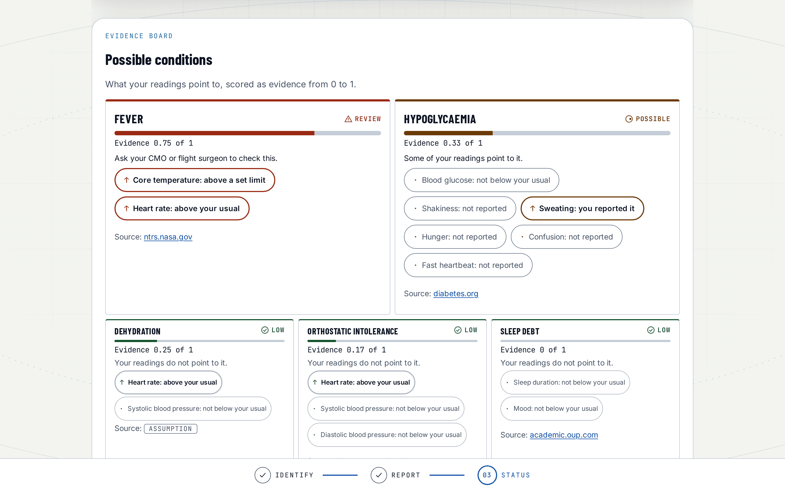
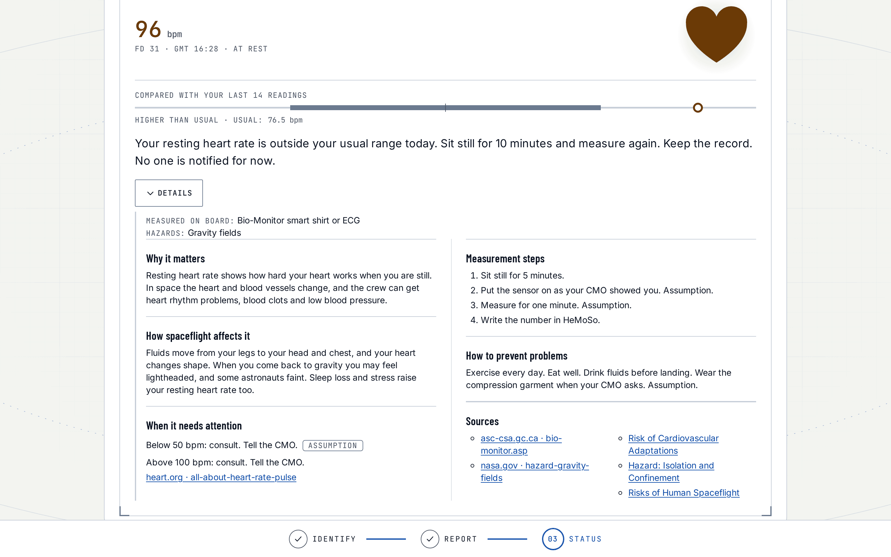
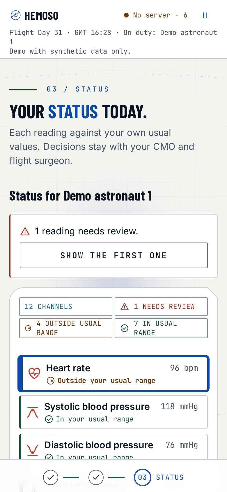

# HeMoSo

**Your health, checked against your own usual range, wherever the doctor is far away.**

Team ReTardis · NASA Space Apps Challenge 2026 · Medellín
(https://www.spaceappschallenge.org/2026/find-a-team/tardis2/) · Challenge:
*Create Health Monitoring Software for Astronauts on Space Missions*
(`docs/CHALLENGE.md`).

- **Live app:** https://www.hemoso.space/ (synthetic data only, no login for the demo)
- **Demo video:** link coming (placeholder until the team publishes it)

<p align="center">
  
</p>

## Why HeMoSo

- **The problem.** On a deep-space mission, medical care from Earth gets harder
  to reach. NASA's Human Research Program lists distance from Earth as one of
  the five hazards: "Instructions, new supplies, medical care, and more become
  increasingly challenging to receive from Earth"
  (https://www.nasa.gov/hrp/hazards/).
- **Who uses it.** The crew member records a daily check. The crew medical
  officer (CMO) and the flight surgeon on Earth are the people the app names
  when a result needs attention. It does not replace either of them.
- **What changes for the crew.** Each reading is shown against the person's
  own usual range and against limits that cite a source, with the next step in
  plain words and who acts. It works offline and sends the data when the link
  returns.

## What it does

<table>
  <tr>
    <td width="50%" valign="top">
      
      <br><sub><b>Identify.</b> Sign in with a PIN, or open the synthetic demo astronaut.</sub>
    </td>
    <td width="50%" valign="top">
      
      <br><sub><b>Report.</b> One row per indicator, with its context and the earlier readings.</sub>
    </td>
  </tr>
  <tr>
    <td width="50%" valign="top">
      
      <br><sub><b>Possible conditions.</b> An evidence score from 0 to 1, the signals behind it and its source. The CMO or flight surgeon confirms.</sub>
    </td>
    <td width="50%" valign="top">
      
      <br><sub><b>Details.</b> Why it matters, how to measure it, when it needs attention, with sources.</sub>
    </td>
  </tr>
</table>

On a phone, Status keeps the same content in one column:

<p align="center">
  
</p>

## Why you can trust what it says

A plausible system that uses what actually flies, with rules you can check.

- **Every limit has a source you can open.** Each threshold in
  [`config/rules/attention.csv`](config/rules/attention.csv) carries a link or
  the word `Assumption`, and the app shows it next to the result. The links are
  collected in [`docs/sources.md`](docs/sources.md).
- **The same rule in two places.** Your own baseline is computed by one rule
  ([`docs/findings/phys-02-baseline-state-rule.md`](docs/findings/phys-02-baseline-state-rule.md))
  in the API ([`backend/app/state.py`](backend/app/state.py)) and in the app
  ([`frontend/src/domain/state.ts`](frontend/src/domain/state.ts)). The app is
  tested against that finding's vectors
  ([`scripts/fixtures/format_rules/window.json`](scripts/fixtures/format_rules/window.json)).
- **A sourced limit comes first.** It is checked before the baseline, so a core
  temperature of 39.5 °C on day 1, with no history, already needs review (the
  cited row is above 38.0 °C). A row marked `Assumption` never raises an alarm
  on its own ([`FORMATS.md`](FORMATS.md) section 3,
  [`phys-02`](docs/findings/phys-02-baseline-state-rule.md)).
- **Instruments documented for the ISS** (the values are typed in; the app does
  not connect to the devices), from the sourced rows of
  [`config/data/indicators.csv`](config/data/indicators.csv): the Bio-Monitor
  smart shirt (heart rate, blood pressure), the T-Mini headband (core
  temperature), the Actiwatch (sleep), the i-STAT blood analyser (glucose, one
  fingerstick at a time), SLAMMD (body mass), the metered galley dispenser (fluid intake) and the ISS
  Reaction Self Test (our check is a 90-second adaptation). Mood and appetite
  are questions the crew answers.
- **Never a diagnosis.** Possible conditions are an evidence score with its
  signals ([`docs/findings/bio2-02-evidence-score.md`](docs/findings/bio2-02-evidence-score.md)),
  the `notify` column names who acts (crew, CMO, flight surgeon), and the tool
  is never a diagnosis or a replacement for either doctor (REQ-11).

Every value in the app, in the database and in the deployments is synthetic
(REQ-14). There are no real personal health data anywhere.

## Built for a real mission

- **Built on instruments documented for the ISS.** The instruments named in
  [`config/data/indicators.csv`](config/data/indicators.csv), each with a
  source link: Bio-Monitor smart shirt, T-Mini core temperature headband,
  Actiwatch, i-STAT blood analyser, the ISS Reaction Self Test (our check is a
  90-second adaptation), the metered galley dispenser and SLAMMD. The values are
  typed into the app; it does not connect to those devices. Mood and appetite are
  daily questions.
- **Works without contact with Earth.** Readings are saved on the device and
  an outbox sends them when the link returns
  ([`docs/API.md`](docs/API.md), REQ-13 in
  [`docs/requirements.md`](docs/requirements.md)).
- **Crew, then crew medical officer, then flight surgeon.** The `notify`
  column of [`attention.csv`](config/rules/attention.csv) names who acts,
  possible conditions are an evidence score
  ([`bio2-02`](docs/findings/bio2-02-evidence-score.md)), and the tool is
  never a diagnosis or a replacement for either doctor (REQ-11).
- **NASA crew terms.** Flight Day, GMT and Post-sleep, with plain words beside
  them ([`STANDARDS.md`](STANDARDS.md) glossary).

## What HeMoSo is

HeMoSo is a health monitoring application for astronauts on a mission, meant
for daily use. Each astronaut signs in, records their readings, symptoms and
pain, and sees each value against their own usual range and against attention
limits with a source. The app says the next step in plain words and who acts:
the crew, the crew medical officer (CMO) or the flight surgeon. A possible
condition is shown as evidence with what it rests on, never as a certainty or a
percentage, and the CMO or the flight surgeon confirms it. HeMoSo does not
replace them.

**What it does today** (live at https://www.hemoso.space)

- **Identify:** sign in with a username and a PIN, or open the synthetic demo
  astronaut. Face sign-in is optional and stays on the device.
- **Report:** one row per indicator (12 indicators, `config/data/indicators.csv`)
  with its context (post-sleep, pre-sleep, rest…), an optional symptom list, a
  3D body to mark pain or an injury, and an optional 90-second reaction check
  (light or sound).
- **Status:** each indicator in one of four states (no data yet, in your usual
  range, outside your usual range, needs review), the possible conditions with
  their evidence and signals, "Call your CMO now" before any score when a red-flag
  symptom is reported, and the history of each indicator as a trend.
- **Offline first:** everything is saved in the browser and an outbox sends it
  to the API when there is a connection, without duplicates (REQ-13). Reloading
  the page with no network is not part of this build.

**How a value is judged** (`FORMATS.md` section 3)

- **Own baseline:** the last 14 mission days that hold a reading in the same
  context, each day counted once as the mean of its readings; the median and the
  spread (`max(1.4826 × MAD, min_spread)`) over those daily values; fewer than 3
  days is "no data yet"; more than 3 spreads from the median is "outside your
  usual range" (`docs/findings/phys-02-baseline-state-rule.md`).
- **Attention limits:** a row of `config/rules/attention.csv` with a cited source
  is checked first, even without a baseline (39.5 °C on day 1 needs review); a
  value on the threshold counts ("140/90 or higher"); a row marked `Assumption`
  never raises an alarm on its own.
- **Possible conditions:** `config/rules/conditions.csv` scores each signal and
  each reported symptom (`config/data/symptoms.csv`) into an evidence score from
  0 to 1 with a three-step label (`docs/findings/bio2-02-evidence-score.md`).

## Run it

Prerequisites, from `docs/STACK.md`:

| Tool | Version |
| --- | --- |
| Python | 3.13 |
| uv | 0.13 |
| Node | 24 LTS (22.12 minimum) |
| pnpm | 12, through `npx -y pnpm@12.20.0`; no global install needed |

### Backend (API)

From `backend/`:

```bash
uv sync --frozen                            # install from uv.lock
cp .env.example .env                        # see the table below; empty values work locally
uv run --env-file .env python -m app.seed   # load config/data/demo_data.csv; prints added and skipped
uv run --env-file .env uvicorn app.main:app --port 8000
```

The API answers on http://127.0.0.1:8000; `GET /health` returns
`{"status":"ok"}` and the interactive docs are at `/docs`. Uvicorn does not read
`.env` on its own, so pass `--env-file .env`. The contract is in `docs/API.md`.

`backend/.env` (git ignores it; `.env.example` lists the names):

| Variable | Locally | In production (Railway) |
| --- | --- | --- |
| `STORAGE` | empty: SQLite file | `supabase` |
| `SQLITE_PATH` | empty: `backend/entries.db` | not used |
| `CONFIG_DIR` | empty: the repository's `config/` | empty |
| `SUPABASE_URL`, `SUPABASE_KEY` | empty | the project URL and the **service role** key, pasted in Railway only |
| `ALLOWED_ORIGINS` | empty: allows http://localhost:5173 | `https://www.hemoso.space,https://hemoso.space,https://hemoso-eta.vercel.app` |
| `RATE_LIMIT_PER_MINUTE` | empty: 120 | 120 |
| `SESSION_SECRET` | empty is fine (see below) | **required**: a long random value |

**`SESSION_SECRET`** signs the session tokens (HMAC-SHA256). When it is empty
the API makes a random one at start and warns that every restart signs everyone
out, which is fine on a laptop and wrong in production. Make one with
`python -c "import secrets; print(secrets.token_urlsafe(48))"` and paste it only
into Railway (service `hemoso`, Variables); never into the repository, Vercel
or a chat (`docs/PRIVACY.md`).

### Accounts and the PIN (REQ-37)

- `POST /accounts` with `{"person_id": "demo_crew_2", "pin": "2468"}` creates an
  account; `person_id` is lowercase `snake_case`, the PIN is 4 to 8 digits.
- The PIN is never stored: the API keeps a per-account salt and the
  `hashlib.scrypt` hash (`n`=2**14, `r`=8, `p`=1), and never logs it.
- `POST /sessions` with the same body returns `token` and `expires_at`; every
  route that names a person with an account needs `Authorization: Bearer <token>`
  for that person (401 without it, 403 for another person's token).
- 5 wrong PINs within 10 minutes lock that person for the rest of the window
  (429). The answer never says whether an account exists.
- The synthetic demo astronaut has no account, so the public demo opens without a
  PIN. Face sign-in only unlocks a PIN saved on that device; the face never
  leaves it (`docs/DECISIONS.md`, `docs/PRIVACY.md`).

### Pain and symptoms

- **Pain and injuries** (3D body): `POST /people/{person_id}/pain` with a body
  region, a kind (`pain`, `swelling`, `bruise`, `cut_or_scrape`, `burn`,
  `sprain_or_strain`), an intensity from 0 to 10, the mission day and time and an
  optional note; `GET` lists them. The app keeps them in the browser and sends
  them through the outbox. The intensity is stored as the astronaut set it and is
  never read as a sign of anything.
- **Symptoms:** the list is `config/data/symptoms.csv` (id, name, red flag,
  shared, source). `POST /people/{person_id}/symptoms` stores one report with a
  severity of 1, 2 or 3; `GET` lists them. In the condition score a reported
  symptom listed in the condition's `symptoms` column adds 0.5 (0.25 when it is
  shared by two conditions); a symptom-only score stops at Possible; a red-flag
  symptom makes the condition `urgent`, and the app shows "Call your CMO now"
  before any score.
- Sending the same report twice adds nothing (200); a different report for the
  same moment is a 409. Details and examples: `docs/API.md`.

### The Supabase database (production)

Locally the API uses SQLite and creates its tables itself. In Supabase, run
`backend/supabase/schema.sql` once in the SQL editor (Dashboard → SQL editor →
New query). It creates, each block on its own so a project can run only the
blocks it lacks:

| Table | Holds | Natural key |
| --- | --- | --- |
| `entries` | the readings, with their `context` | person, indicator, mission day, time |
| `accounts` | person id, salt, PIN hash, `mission_start` | person id |
| `pain_reports` | region, `kind`, intensity, note | person, region, mission day, time |
| `symptom_reports` | symptom id, severity | person, mission day, time, symptom |

Every table has row level security on and no policy: only the API, with the
service role key, reads or writes rows; the public (anon) key reads nothing.
Load the demo readings once with the seed command above and `STORAGE=supabase`;
do not run it again unless the table was emptied.

### Frontend (app)

From `frontend/`:

```bash
npx -y pnpm@12.20.0 install --frozen-lockfile
VITE_API_BASE_URL=http://127.0.0.1:8000 npx -y pnpm@12.20.0 run dev
npx -y pnpm@12.20.0 run build               # type-check and build to dist/
```

The dev server prints its address (http://localhost:5173). Without
`VITE_API_BASE_URL`, everything stays in the browser and the app works the same.

### How they connect

The app reads the API URL from `VITE_API_BASE_URL`, never a hard-coded host.
The API accepts the Vite dev server origin when `ALLOWED_ORIGINS` is unset or
empty: `backend/app/main.py` then allows http://localhost:5173. For any other
origin, list it in `ALLOWED_ORIGINS`, comma-separated. The app reads `config/`
from the repository root at build time, so both folders stay where they are.

### Tests

```bash
# backend, from backend/
uv run ruff check . && uv run pytest
# frontend, from frontend/
npx -y pnpm@12.20.0 run lint && npx -y pnpm@12.20.0 run test
npx -y pnpm@12.20.0 run e2e                 # Playwright, the demo path in a browser
```

**The baseline window and the shared vectors.** The rules the backend and the
app must compute the same way have one set of cases each, in
`scripts/fixtures/format_rules/`: `baseline.json` (the state band),
`attention.json` (the attention limits) and `window.json` (the daily window of
`phys-02`, seven cases with every history written out). Run them with:

```bash
python -m unittest discover -s scripts -p "test_window_fixture.py"   # the file agrees with the rule
npx -y pnpm@12.20.0 --dir frontend exec vitest run src/domain/state.test.ts   # the app's state.ts against window.json and baseline.json
cd backend && uv run pytest tests/test_state.py                      # the API's state.py
```

If a rule changes, change the finding first, then the JSON, then both
implementations in the same pull request: the tests fail on whichever side was
left behind.

### Checks before a push

From the repository root (`AGENTS.md` rule 6); GitHub runs the same checks on
every push and pull request (`.github/workflows/checks.yml`).

```bash
python -m unittest discover -s scripts -p "test_*.py"   # team script tests
python scripts/check_content.py --strict                # config/ against FORMATS.md, every file required
python scripts/check_sources.py                         # links: FAIL only when gone, WARN to open in a browser
python scripts/si_use.py --check                        # SI-USE.md matches the SI log
python scripts/precheck.py                              # branch, paths, messages, secrets
```

## Project map

| Path | Holds |
| --- | --- |
| `backend/` | FastAPI API: health, accounts and sessions, entries, history, state, conditions, pain and symptoms; SQLite by default, Supabase by `STORAGE` |
| `frontend/` | Vite, React and TypeScript app in three phases: Identify, Report and Status |
| `config/` | The health content and data the app reads: indicators, demo data, attention rules, conditions, per-indicator text (`FORMATS.md`) |
| `docs/` | Requirements, decisions, API contract, tools and versions, deploy, privacy, sources, NASA data, findings |
| `scripts/` | Team scripts: precheck, board, content and source checks, and the shared rule vectors in `scripts/fixtures/format_rules/` |
| `submission/` | Pitch script, slides, video and the submission text |
| `team/` | One folder per person: role, status, log and notes |
| `.github/` | The checks that run on every push and pull request |

Key documents: `docs/API.md` (the API contract), `docs/DEPLOY.md` (public links
and the video), `docs/PRIVACY.md` (what is stored and where the keys live),
`FORMATS.md` (the files in `config/`), `SI-USE.md` (how SI tools helped).
Requirements: `docs/requirements.md`. Decisions: `docs/DECISIONS.md`.

## Live demo

- App: https://www.hemoso.space (synthetic data only; open in a private window, no login)
- API: https://hemoso-production.up.railway.app (`/health`, interactive docs at `/docs`)
- Face sign-in: on the Identify screen and optional; it needs one PIN sign-in on
  that device first, and the face data stays on the device (`docs/PRIVACY.md`).

---

## How we work

| Role | GitHub | Branch | Agent | Personal folder |
| --- | --- | --- | --- | --- |
| Bio 1 · Health content and pitch | @sofiaruizt | `bio1` | `bio1` | `team/bio1/` |
| Bio 2 · Rules, thresholds and submission | @pamirestrepo-code | `bio2` | `bio2` | `team/bio2/` |
| Phys · Data, NASA sources and measurement | @IsabellaCabreraquintero | `phys` | `phys` | `team/phys/` |
| Eng 1 · Integrator, frontend and requirements | Wambi (@Sadriica) | `eng1` (and merges into `main`) | `eng1` | `team/eng1/` |
| Eng 2 · Backend and demo | Juli (@julimejia) | `eng2` | `eng2` | `team/eng2/` |

Full rules: `AGENTS.md`. `config/` formats (from Saturday 10:00): `FORMATS.md`. Units, glossary,
findings and status messages: `STANDARDS.md`. Skills: `SKILLS.md`.
Saturday setup: `docs/SETUP.md`. Board: `docs/BOARD.md`.
Tools and versions: `docs/STACK.md`. Public links and video: `docs/DEPLOY.md`.
Decisions and rejected options: `docs/DECISIONS.md`.
Privacy: `docs/PRIVACY.md`. SI use: `SI-USE.md`.

### The usual way: ask your agent
- "save my progress" → checks the branch, proposes `git add` of your paths, commit and push.
- "pull main" → brings in the latest after a checkpoint.
- "@reviewer review my last change" → review without editing.
- "show my cards", "start #12", "send #12 to review" → the board (`kanban` skill).

### If the agent fails: five commands
```bash
git branch --show-current                 # 1. am I on my branch?
git status                                # 2. what did I change?
git add <my files>                        # 3. never "git add ."
git commit -m "type(area): what changed"  # 4. one sentence, in English
git push                                  # 5. upload
```
Pull `main`: `git fetch origin && git merge origin/main`.

### Checkpoints
Saturday 12:00 · Saturday 17:00 · Sunday 8:00 (feature freeze) · Sunday 13:00 (submission).
Internal freeze Sunday 13:30; official close Sunday 23:59 local.
15 minutes before: update `team/<person>/README.md`, commit, push and post
"ready". Eng 1 merges, tests and tags (`cp1`, `cp2`, `cp3`, `submission`).

### Never
`git push --force` · `git reset --hard` · `git rebase` · commit to `main` ·
commit `.env` or keys · touch someone else's files.
